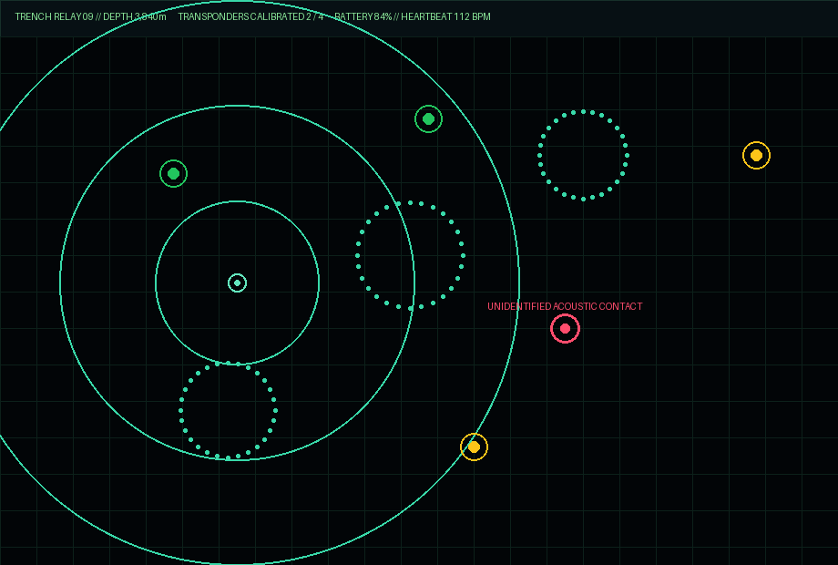

# Signal Lost - Trench Relay 09

A deep-ocean acoustic sonar survival horror game built with HTML5 Canvas. Pilot a blind bathysphere at 3,840 meters depth where nothing is visible until illuminated by active sonar pings — but every ping reveals your coordinates to an acoustic trench predator.

## Gameplay & Mechanics

- **Blind Echo-Location Navigation** Cavern walls and deep-trench transponders remain pitch-black until struck by an expanding sonar wave (`SPACE` or Left Click), leaving phosphor point-cloud echoes that slowly fade.
- **Acoustic Threat AI** Emitting active sonar or running thrusters at full power raises your acoustic signature, drawing an unseen trench contact toward the origin of your last ping.
- **Silent Running (`F`)** Cut main thrusters and suppress acoustic emissions to let the predator pass in the dark while regenerating battery reserves.
- **Transponder Calibration** Hold position within 45 meters of all 4 abyssal relay beacons to restore surface telemetry and escape the trench.

## Play Online

Live playable build: `https://aariv.me/signal-lost-station/`
